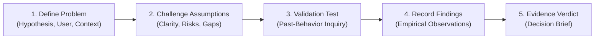

# ProblemPilot — The Evidence Challenge
> **"Don't build on assumptions. Challenge them with evidence."**
> 
> *Built for the PromptWars × KickToTech 2026 Hackathon*

---

## 1. Executive Summary

**ProblemPilot** is a disciplined, AI-assisted problem-validation application for engineers, student innovators, and early-stage founders. Rather than encouraging premature development based on polite enthusiasm or vague ideas, ProblemPilot enforces an explicit chain of evidence:

$$\text{CLAIM} \longrightarrow \text{ASSUMPTIONS} \longrightarrow \text{EVIDENCE GAPS} \longrightarrow \text{VALIDATION EXPERIMENT} \longrightarrow \text{OBSERVED FINDINGS} \longrightarrow \text{DECISION BRIEF}$$

The application challenges unverified claims, identifies target-user ambiguity, generates actionable non-leading validation experiments, evaluates user-submitted empirical findings, and synthesizes a grounded decision brief.

---

## 2. Target Users & Core Problem

### Target Audience
- **Hackathon participants & student innovators**: Moving too quickly from vague ideas to full-stack prototypes without validating whether the problem exists.
- **Software engineers & early-stage founders**: Spending weeks or months coding solutions before checking whether current workarounds already satisfy users.

### The Problem
People routinely begin building software before establishing:
1. Who specifically experiences the friction.
2. In what exact operational context it occurs.
3. Why existing workarounds (e.g., Google Calendar, Notion, spreadsheets, paper) fail.
4. What empirical behavioral evidence supports the claim that the problem warrants a new product.

---

## 3. The 5-Stage Core Validation Workflow

ProblemPilot implements a strict, enforceable 5-stage state machine:
`DRAFT` $\rightarrow$ `ANALYZED` $\rightarrow$ `TEST_DEFINED` $\rightarrow$ `FINDINGS_ENTERED` $\rightarrow$ `EVIDENCE_REVIEWED`



### Stage 1 — Define the Problem (`DRAFT`)
- Captures the proposed idea, target user profile, operational context, existing observations, and research constraints.
- Identifies broad solution categories (e.g., *"An AI app for students"*) and flags missing specificity without inventing facts.

### Stage 2 — Challenge Assumptions (`ANALYZED`)
- Evaluates **Problem Clarity** (`clear`, `incomplete`, `vague`) with explicit missing details enumerated.
- Surfaces **Unverified Assumptions** with unique IDs (`ASM-1`, `ASM-2`), risk levels (`high`, `medium`, `low`), required evidence, and recommended next actions.
- Identifies **Evidence Gaps**, **Alternative Explanations**, and **Existing Workarounds**.

### Stage 3 — Design Validation Experiment (`TEST_DEFINED`)
- Generates the smallest practical test that reduces the highest-risk uncertainty.
- Formulates **Strictly Non-Leading Past-Behavior Inquiry Questions** (e.g., *"Tell me about the last time you experienced this. What tool or workaround did you use?"*).
- Prohibits leading hypotheticals (*"Would you love an app that...?"*).
- Specifies execution protocol, evidence checklist, supporting signals, weakening signals, and limitations.

### Stage 4 — Record Findings (`FINDINGS_ENTERED`)
- Captures empirical observations categorized by source: `direct_observation`, `user_reported_experience`, `interpretation`, or `assumption`.
- Maps findings to specific assumptions under evaluation.
- Flags polite enthusiasm (*"Everyone loved this idea!"*) as subjective opinion lacking behavioral evidence.

### Stage 5 — Review Evidence & Issue Grounded Verdict (`EVIDENCE_REVIEWED`)
Synthesizes findings against claims and outputs **exactly one primary decision category**:
1. **`INSUFFICIENT EVIDENCE`**: Available findings do not justify a conclusion (sample too small, purely subjective praise, or empty records).
2. **`REVISE THE HYPOTHESIS`**: Findings demonstrate that users find existing workarounds satisfactory or that friction is negligible.
3. **`EVIDENCE SUPPORTS FURTHER TESTING`**: Observations indicate genuine recurring friction justifying deeper investigation (does **not** guarantee market demand or product-market fit).

> [!IMPORTANT]
> **Responsible AI Principle:** ProblemPilot **never** outputs *"PROVEN"* or *"GUARANTEED MARKET DEMAND"*. A single observation never establishes universal truth.

---

## 4. State Transitions & Evidence Integrity

- **Strict Transition Guards:** Users cannot skip stages via URL or DOM manipulation. Stage 5 requires recorded empirical findings.
- **Hypothesis Invalidation (Dirty State):** Modifying the problem statement after Stage 2 flags existing analyses and experiments as **outdated/stale** and requires re-analysis before a verdict can be synthesized.
- **Non-Destructive Backwards Navigation:** Users can return to earlier stages at any time without destroying recorded findings or entered hypotheses.
- **Safe Reset:** Confirmation modal prevents accidental data loss.

---

## 5. Technology Stack

- **Frontend**: React 19 + TypeScript (Strict mode, `erasableSyntaxOnly` & `verbatimModuleSyntax` compliant)
- **Toolchain**: Vite 8 (Dev server, HMR, production bundler)
- **Styling**: Tailwind CSS v4 (`@tailwindcss/vite`) with an analytical, high-contrast dark palette (anti-slop, zero neon/rainbow AI gradients)
- **Icons**: Lucide React
- **AI Core**: Google Gemini API via official `@google/genai` SDK (`gemini-2.5-flash`)
- **Server Architecture**: Vite Connect API Middleware (`/api/analyze`, `/api/test`, `/api/review`) keeping `GEMINI_API_KEY` strictly server-side
- **Testing**: Vitest 5 (105 automated unit and contract tests)
- **Local Persistence**: Versioned LocalStorage with schema validation

---

## 6. Quick Start & Setup Instructions

### Prerequisites
- Node.js `v20+` or `v22+` (Tested on Node `v22.23.1`)
- npm `10+`

### Installation
```bash
# Clone repository
git clone https://github.com/TanmayPatil28/KickToTech.git
cd KickToTech

# Install dependencies
npm install
```

### Running Locally
```bash
# Start development server with API middleware
npm run dev
```
Open **`http://localhost:5173`** in your browser.

### Building for Production
```bash
# Compile and bundle
npm run build
```

---

## 7. Environment Variables & Live AI Configuration

ProblemPilot handles API keys **strictly on the server side**. API keys are never exposed in client bundles or network inspection.

### Configuration
Set the `GEMINI_API_KEY` environment variable in your terminal or `.env` file:

```bash
# PowerShell (Windows)
$env:GEMINI_API_KEY="your-gemini-api-key"

# Bash / Zsh (macOS / Linux)
export GEMINI_API_KEY="your-gemini-api-key"
```

### Transparent Fallback
If `GEMINI_API_KEY` is missing, invalid, or rate-limited:
- The system **never** crashes or halts.
- It automatically engages the verified, deterministic heuristic analysis engine.
- A transparent system banner informs the user that local heuristic evaluation is active.

---

## 8. Deterministic Demo Mode

ProblemPilot includes a deterministic, offline-capable Demo Mode accessible from the header dropdown.

### Scenario A — Vague Student Study App
- **Initial Input:** `"An AI app that helps college students study better."`
- **Behavior:** The analytical engine detects that this is a broad solution category rather than an understood problem. It flags missing details (which study phase fails, which subgroup experiences friction) and extracts 3 high-risk unverified assumptions.

### Scenario B — Contradictory Findings
- **Scenario:** Exam revision study assistant.
- **Findings:** Pre-loaded observations show that students already use Google Calendar and Notion templates with high satisfaction, and friction is driven by procrastination rather than tool inadequacy.
- **Verdict:** Evaluates to **`REVISE THE HYPOTHESIS`** with an explicit rationale explaining why existing workarounds negate the need for a new general study tool.

> [!NOTE]
> Every demo session carries a persistent badge: **`SAMPLE SCENARIO — NOT REAL RESEARCH`**. Demo data is never silently substituted for live failures.

---

## 9. Automated Test Suite (105 Tests)

Run the full automated test suite:
```bash
npx vitest run
```

### Verified Test Matrix
1. **Test 1 (Vague Idea):** Identifies missing specificity and marks clarity as `vague`/`incomplete`.
2. **Test 2 (Specific Problem):** Recognizes detailed user and context parameters without overstating evidence.
3. **Test 3 (Empty / Whitespace Input):** Inline validation rejects input and prevents API calls.
4. **Test 4 (Malformed AI Response):** Boundary verification catches malformed schemas and falls back safely.
5. **Test 5 (Missing Credentials):** Graceful fallback to verified heuristic rules without exceptions.
6. **Test 6 (Unsupported Subjective Praise):** Evaluates *"Everyone loves this idea"* as `INSUFFICIENT EVIDENCE`.
7. **Test 7 (Contradictory Findings):** Detects workaround satisfaction and issues `REVISE THE HYPOTHESIS`.
8. **Test 8 (Empty Findings):** Blocks empty findings from receiving a positive verdict.
9. **Test 9 (State Transitions):** Step-skipping is strictly rejected by transition guards.
10. **Test 10 (Hypothesis Modification):** Changing problem text flags previous analysis as outdated/stale.
11. **Test 11 (Mobile Layout):** Verified non-overflowing responsive grid on 375px+ viewports.
12. **Test 12 (Demo Mode):** Displays persistent `SAMPLE SCENARIO — NOT REAL RESEARCH` indicator.
13. **Test 13 (Reset Action):** Confirmation modal cleanly resets state without orphaned data.
14. **Test 14 (Build & Runtime):** TypeScript strict compilation and Vite bundling pass in <1 second.

---

## 10. Known Limitations & Responsible AI

1. **Self-Reported Evidence:** ProblemPilot evaluates evidence entered by the user. It cannot independently verify whether a user truthfully conducted an interview.
2. **Small-Sample Scope:** A successful Stage 5 verdict (`EVIDENCE SUPPORTS FURTHER TESTING`) indicates that initial empirical signals justify deeper investigation—it does **not** prove product-market fit or business viability.
3. **No External Web Scraping:** The system relies on model reasoning and user observations rather than automated web scraping.

---

## 11. License

MIT License. See [LICENSE](LICENSE) for details.
