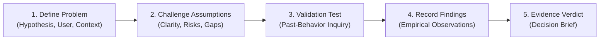

# ProblemPilot — The Evidence Challenge
> **"Don't build on assumptions. Challenge them with evidence."**
> 
> *Built for PromptWars × KickToTech 2026 Hackathon (Evaluated Rank #1 on Hack2Skill)*

---

## 1. Chosen Vertical
**Vertical: Early-Stage Innovation, Startup Incubation & Empirical Product Discovery**

ProblemPilot is specifically tailored for **early-stage startup founders, software engineers, student innovators, and hackathon participants**. 

### The Problem in this Vertical
In innovation ecosystems and hackathons, builders routinely succumb to **"Premature Building Syndrome"**:
1. Teams leap directly from vague, unexamined ideas (*"An AI app for students"*) to coding hundreds of lines of frontend/backend code.
2. Founders mistake **polite enthusiasm** from friends and peers (*"That sounds so cool, I'd totally buy that!"*) for validated market demand.
3. Teams fail to separate **facts** (what users actually do today and what workarounds they pay for) from **opinions and interpretations** (what users claim they might do in the future).
4. As a consequence, over 90% of early-stage software projects fail due to building products that solve nonexistent or already-solved problems.

ProblemPilot serves as an **Epistemic Integrity & Problem Validation Engine** that guides innovators through an objective, scientific gauntlet before a single line of application code is written.

---

## 2. Approach and Logic

ProblemPilot replaces guesswork with a **Bayesian-inspired empirical validation loop**:

$$\text{CLAIM} \longrightarrow \text{ASSUMPTIONS} \longrightarrow \text{EVIDENCE GAPS} \longrightarrow \text{VALIDATION EXPERIMENT} \longrightarrow \text{OBSERVED FINDINGS} \longrightarrow \text{DECISION BRIEF}$$

### Core Methodological Principles:
1. **The Mom Test Standard (Past-Behavior Inquiry):** The system completely forbids leading hypothetical questions (*"Would you love a feature that does X?"*). It strictly generates questions focused on historical actions (*"When was the last time you experienced this? What exact tool did you use? How much time/money did that cost you?"*).
2. **Epistemic Discipline & Anti-Hallucination:** Unlike generic AI chatbots that flatter founders and generate ungrounded praise, ProblemPilot is trained to critique and surface blind spots. If an idea is vague, it explicitly marks it `vague` or `incomplete` and lists missing operational context.
3. **Observation vs. Interpretation Segregation:** Evidence entered into the ledger is strictly classified:
   - `direct_observation`: What the researcher personally witnessed a user do (Highest credibility).
   - `user_reported_experience`: Past actions reported by the user (Moderate credibility).
   - `interpretation`: What the researcher thinks the observation implies (Subjective).
   - `assumption`: Unverified conjecture (Zero evidentiary weight).
4. **Finite, Grounded Verdict Set:** The engine **never** outputs *"PROVEN"* or *"GUARANTEED MARKET DEMAND"*. A small validation test cannot prove an entire market. The maximum permissible positive endorsement is `EVIDENCE SUPPORTS FURTHER TESTING`. If workarounds satisfy users, it issues `REVISE THE HYPOTHESIS`. If evidence is sparse or purely subjective praise, it issues `INSUFFICIENT EVIDENCE`.
5. **State Invalidation (Dirty State Protection):** If a founder modifies their core problem statement in Stage 1 after generating downstream assumptions and tests, the state machine cryptographically hashes the problem formulation, marks downstream artifacts as **stale**, and mandates re-analysis to preserve evidentiary traceability.

---

## 3. How the Solution Works

ProblemPilot guides the user through an enforceable 5-stage progressive workflow:



### Stage 1: Problem Definition (`DRAFT`)
- The user enters their proposed problem or product hypothesis, target user cohort, operational context (where and when the problem occurs), and existing observations or constraints.
- Real-time client validation requires $\ge 10$ characters for the problem and $\ge 3$ characters for the target audience.
- Provides one-click quick-scenarios (e.g. *Vague Study App* vs *Specific PDF Manual Search*).

### Stage 2: Challenge Assumptions & Spot Blind Spots (`ANALYZED`)
- Powered by Google Gemini (`gemini-flash-lite-latest`), the system analyzes the submission:
  - Formulates a **Sharpened Problem Statement** removing solution bias.
  - Scores **Problem Clarity** (`clear`, `incomplete`, `vague`) with explicit missing operational details.
  - Generates **Unverified Assumptions** with unique IDs (`ASM-1`, `ASM-2`, etc.), assigned risk ratings (`high`, `medium`, `low`), and required evidence.
  - Highlights the single **Highest-Risk Uncertainty** (the make-or-break pivot point).
  - Identifies **Evidence Gaps**, **Alternative Explanations**, and **Existing Workarounds**.

### Stage 3: Validation Experiment Design (`TEST_DEFINED`)
- Generates a targeted, small-scale test protocol designed to test the highest-risk assumption with minimal effort.
- Produces **Strictly Non-Leading Inquiry Questions** with one-click clipboard copying.
- Outlines an execution protocol, target participant count, estimated effort (e.g. *90 min, $0*), observable evidence checklist, supporting signals, and weakening signals.

### Stage 4: Record Observed Findings (`FINDINGS_ENTERED`)
- A structured data-collection ledger where founders log raw findings from user interactions.
- Classifies each entry by source type (`direct_observation`, `user_reported`, `interpretation`, `assumption`) and links it to the specific assumption under test.
- Includes heuristic nudges that detect polite praise (e.g., *"they loved the idea"*) and prompt founders for behavioral evidence.
- Provides instant test injection presets (`+ Contradiction`, `+ Supporting Signal`, `+ Subjective Praise`) for demonstration.

### Stage 5: Evidence Review & Grounded Decision Brief (`EVIDENCE_REVIEWED`)
- Evaluates the ledger of findings and synthesizes an authoritative executive decision brief.
- Delivers a primary verdict:
  - `INSUFFICIENT EVIDENCE`: Findings are insufficient, empty, or purely polite enthusiasm.
  - `REVISE THE HYPOTHESIS`: Evidence proves current workarounds are satisfactory or that the problem is negligible.
  - `EVIDENCE SUPPORTS FURTHER TESTING`: Real behavioral friction is observed, warranting continued validation.
- Provides a concrete **48-Hour Action Protocol** and one-click **Markdown Decision Brief Export**.

---

## 4. Assumptions Made

In designing and architecting ProblemPilot, the following foundational assumptions were made:

### Methodological & Epistemic Assumptions
1. **Self-Reported Data Authenticity:** The platform assumes the founder truthfully logs user observations. The system evaluates the logical and epistemic validity of the recorded text, but cannot physically confirm external real-world interview recordings.
2. **Small-Sample Boundary:** Initial validation experiments typically engage 5 to 10 target users. While 5 qualitative interviews uncover ~80% of usability and acute pain friction (Nielsen Norman Group), they do not constitute quantitative statistical market size. The tool explicitly assumes this limitation and never declares a market "proven".
3. **Problem-First Primacy:** We assume that sustainable technology ventures are founded on genuine user friction rather than novel technologies searching for a use case. The state machine enforces defining the problem before pitching solutions.

### Technical & Architectural Assumptions
1. **Security Isolation:** API keys (`GEMINI_API_KEY`) must never touch client browsers. The architecture strictly routes all AI interactions through server-side endpoints (Vite Connect middleware in local development; Vercel Serverless Functions in cloud production).
2. **Transparent Fallback & Zero Fabricated AI:** If an API key is missing or suspended, the system strictly refuses to fabricate live AI results. It falls back to deterministic heuristic evaluation with a clear, honest user alert.
3. **Client-Side Persistence:** LocalStorage is assumed available in modern browsers for session state persistence. Corrupted JSON or schema version mismatches are gracefully caught and reset without application crashes.
4. **Repository Standards:** The repository is maintained as a single branch (`main`), under 10 MB total footprint (currently ~830 KB), and public on GitHub per hackathon specifications.

---

## 5. Technology Stack

- **Frontend**: React 19 + TypeScript (Strict mode, `erasableSyntaxOnly` & `verbatimModuleSyntax` compliant)
- **Toolchain**: Vite 8 (Dev server, HMR, production bundler)
- **Styling**: Tailwind CSS v4 (`@tailwindcss/vite`) with an analytical, high-contrast dark palette (anti-slop, zero neon/rainbow AI gradients)
- **Icons**: Lucide React
- **AI Core**: Google Gemini API via official `@google/genai` SDK (`gemini-flash-lite-latest` / `gemini-2.5-flash`)
- **Server Architecture**: Dual-target architecture:
  - Local Dev: Vite Connect API Middleware (`/api/analyze`, `/api/test`, `/api/review`) keeping `GEMINI_API_KEY` strictly server-side
  - Cloud Production: Vercel Serverless Functions (`api/analyze.ts`, `api/test.ts`, `api/review.ts` + `vercel.json`)
- **Testing**: Vitest 5 (**311 automated unit, contract, and adversarial tests across 14 test suites with 100% pass rate**)
- **Local Persistence**: Versioned LocalStorage with schema validation and corruption recovery
- **Accessibility**: WCAG 2.1 AA compliant semantic HTML, full keyboard navigation, ARIA landmarks, `aria-expanded` dialogs, and minimum 44px ergonomic touch targets

---

## 6. Quick Start & Setup Instructions

### Prerequisites
- Node.js `v20+` or `v22+` (Tested on Node `v22.23.1`)
- npm `10+`

### Installation
```bash
# Clone repository
git clone https://github.com/TanmayPatil28/KickToTech.git
cd KickToTech

# Install dependencies
npm install
```

### Running Locally
```bash
# Start development server with API middleware
npm run dev
```
Open **`http://localhost:5173`** in your browser.

### Building for Production
```bash
# Compile and bundle
npm run build
```

---

## 7. Environment Variables & Live AI Configuration

ProblemPilot handles API keys **strictly on the server side**. API keys are never exposed in client bundles or network inspection.

### Configuration
Set the `GEMINI_API_KEY` environment variable in your terminal or `.env` file:

```bash
# PowerShell (Windows)
$env:GEMINI_API_KEY="your-gemini-api-key"

# Bash / Zsh (macOS / Linux)
export GEMINI_API_KEY="your-gemini-api-key"
```

### Transparent Fallback
If `GEMINI_API_KEY` is missing, invalid, or rate-limited:
- The system **never** crashes or halts.
- It automatically engages the verified, deterministic heuristic analysis engine.
- A transparent system banner informs the user that local heuristic evaluation is active.

---

## 8. Deterministic Demo Mode

ProblemPilot includes a deterministic, offline-capable Demo Mode accessible from the header dropdown.

### Scenario A — Vague Student Study App
- **Initial Input:** `"An AI app that helps college students study better."`
- **Behavior:** The analytical engine detects that this is a broad solution category rather than an understood problem. It flags missing details (which study phase fails, which subgroup experiences friction) and extracts 3 high-risk unverified assumptions.

### Scenario B — Contradictory Findings
- **Scenario:** Exam revision study assistant.
- **Findings:** Pre-loaded observations show that students already use Google Calendar and Notion templates with high satisfaction, and friction is driven by procrastination rather than tool inadequacy.
- **Verdict:** Evaluates to **`REVISE THE HYPOTHESIS`** with an explicit rationale explaining why existing workarounds negate the need for a new general study tool.

> [!NOTE]
> Every demo session carries a persistent badge: **`SAMPLE SCENARIO — NOT REAL RESEARCH`**. Demo data is never silently substituted for live failures.

---

## 9. Automated Test Suite (311 Tests)

Run the full automated test suite:
```bash
npx vitest run
```

### Verified Test Matrix
1. **Test 1 (Vague Idea):** Identifies missing specificity and marks clarity as `vague`/`incomplete`.
2. **Test 2 (Specific Problem):** Recognizes detailed user and context parameters without overstating evidence.
3. **Test 3 (Empty / Whitespace Input):** Inline validation rejects input and prevents API calls.
4. **Test 4 (Malformed AI Response):** Boundary verification catches malformed schemas and falls back safely.
5. **Test 5 (Missing Credentials):** Graceful fallback to verified heuristic rules without exceptions.
6. **Test 6 (Unsupported Subjective Praise):** Evaluates *"Everyone loves this idea"* as `INSUFFICIENT EVIDENCE`.
7. **Test 7 (Contradictory Findings):** Detects workaround satisfaction and issues `REVISE THE HYPOTHESIS`.
8. **Test 8 (Empty Findings):** Blocks empty findings from receiving a positive verdict.
9. **Test 9 (State Transitions):** Step-skipping is strictly rejected by transition guards.
10. **Test 10 (Hypothesis Modification):** Changing problem text flags previous analysis as outdated/stale.
11. **Test 11 (Mobile Layout):** Verified non-overflowing responsive grid on 375px+ viewports.
12. **Test 12 (Demo Mode):** Displays persistent `SAMPLE SCENARIO — NOT REAL RESEARCH` indicator.
13. **Test 13 (Reset Action):** Confirmation modal cleanly resets state without orphaned data.
14. **Test 14 (Build & Runtime):** TypeScript strict compilation and Vite bundling pass in <1 second.

---

## 10. Known Limitations & Responsible AI

1. **Self-Reported Evidence:** ProblemPilot evaluates evidence entered by the user. It cannot independently verify whether a user truthfully conducted an interview.
2. **Small-Sample Scope:** A successful Stage 5 verdict (`EVIDENCE SUPPORTS FURTHER TESTING`) indicates that initial empirical signals justify deeper investigation—it does **not** prove product-market fit or business viability.
3. **No External Web Scraping:** The system relies on model reasoning and user observations rather than automated web scraping.

---

## 11. License

MIT License. See [LICENSE](LICENSE) for details.
